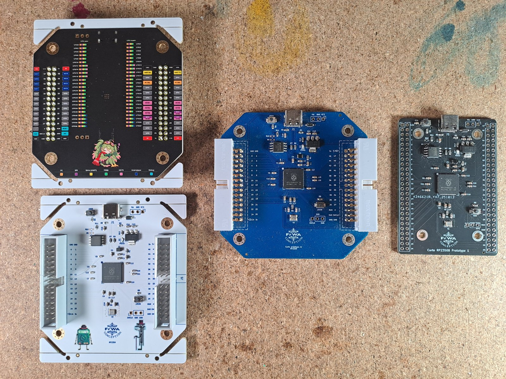
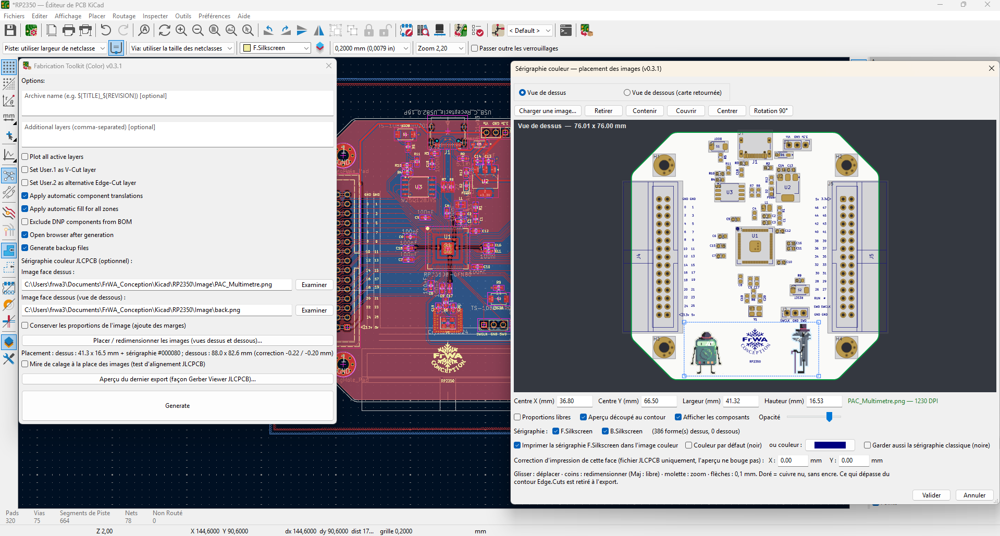
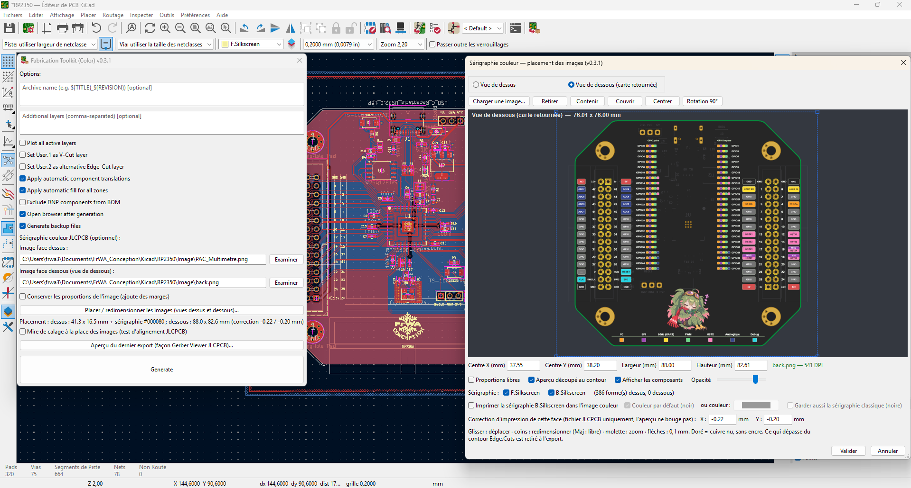
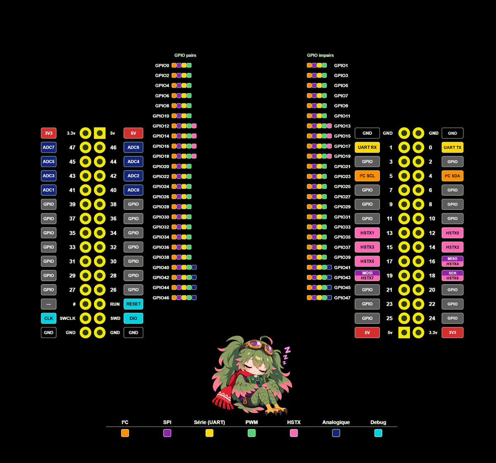
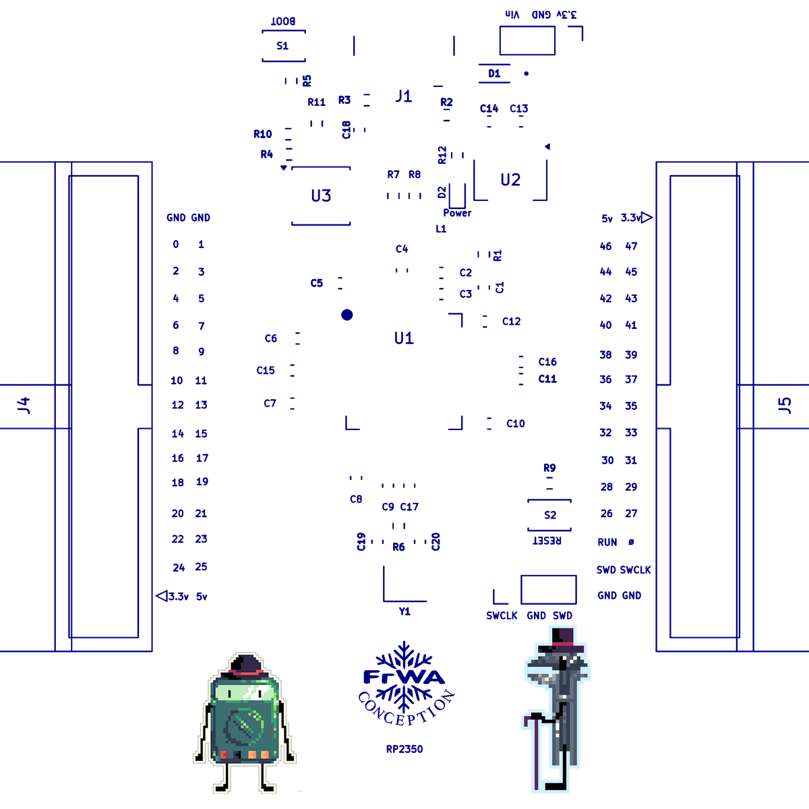
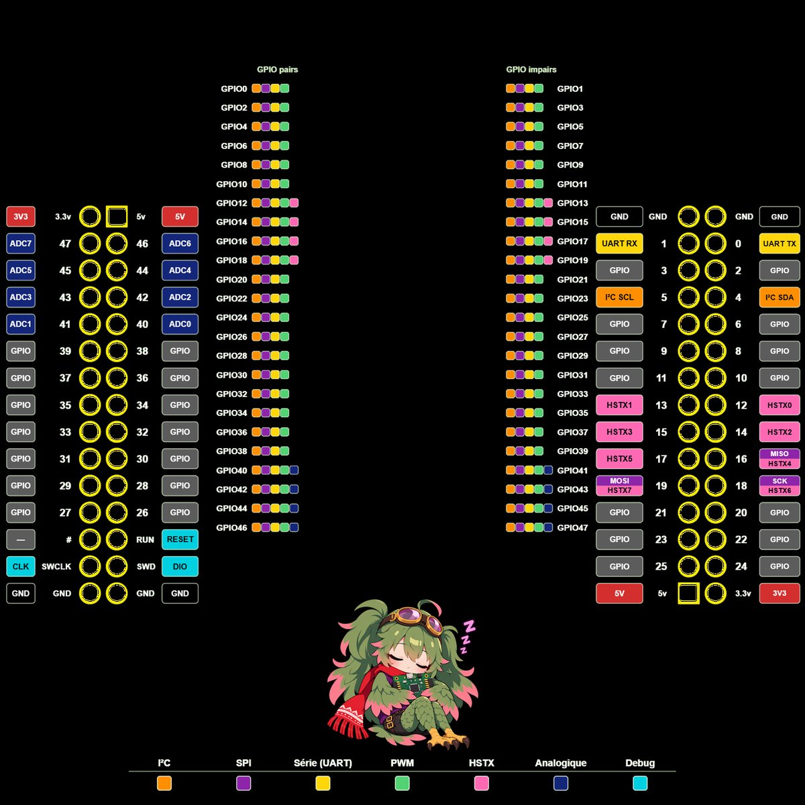
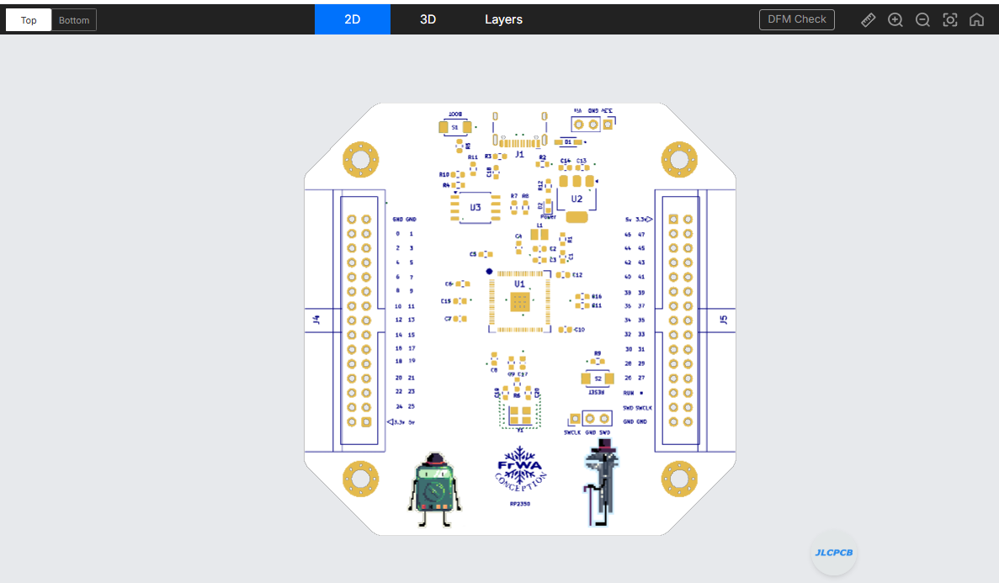
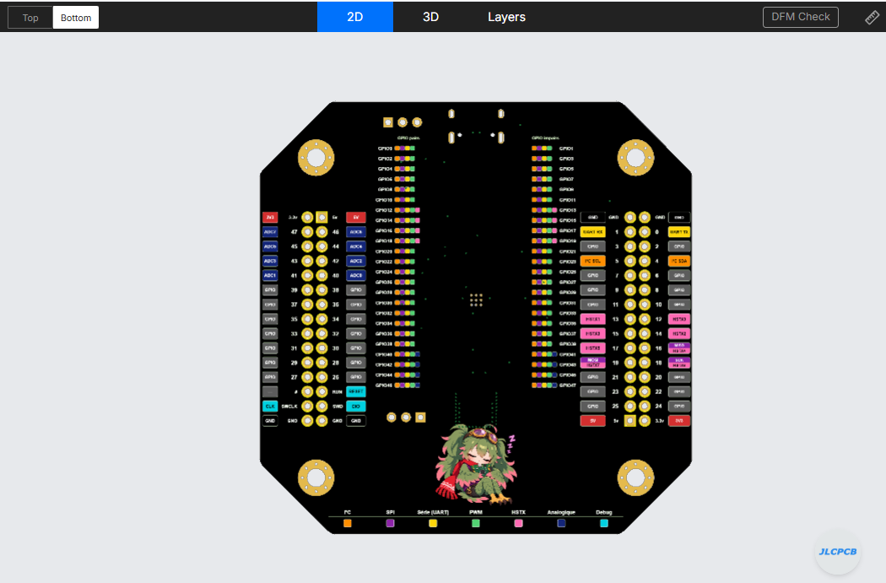
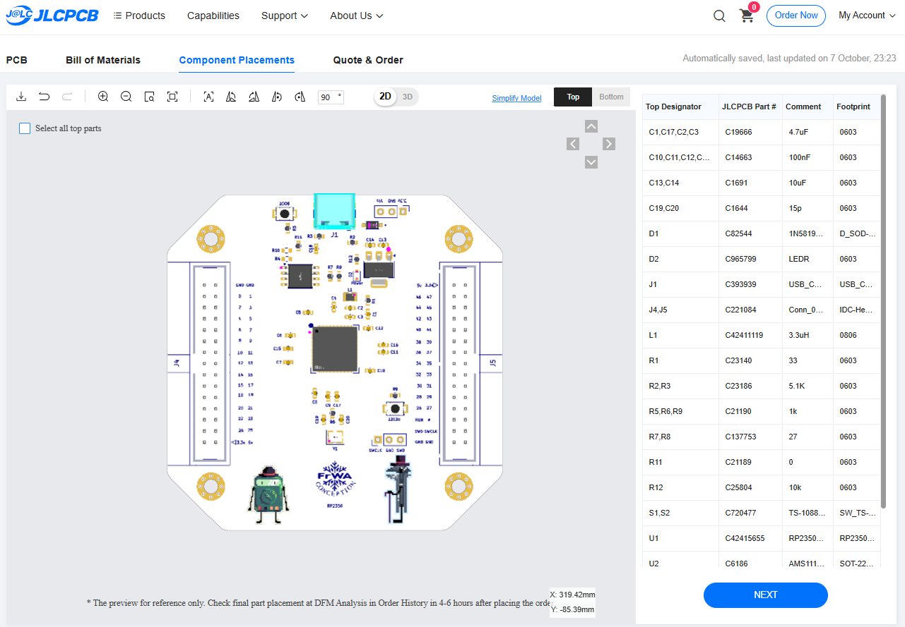
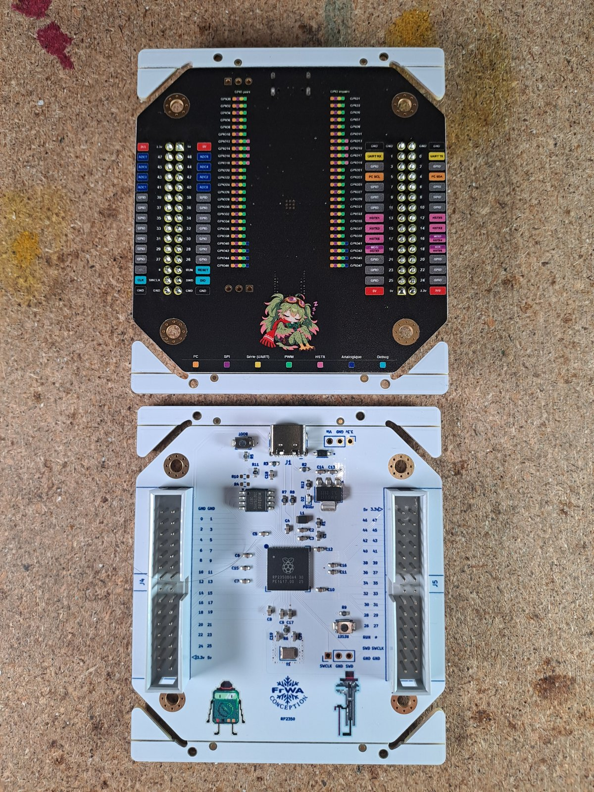

# Fonctionnement du plugin

Cette page suit une carte réelle, la
[carte de développement RP2350B](https://github.com/FrWA14/KiCad10_RP2350B_DevelopmentBoard), du dessin dans
KiCad jusqu'à la carte livrée par JLCPCB. Le détail de chaque option est dans le [README](../README.md).



## Le principe

JLCPCB propose une sérigraphie couleur : une imprimante UV 6 couleurs dépose une image à 1200 DPI sur un PCB
blanc, en finition ENIG. Cette option n'est officiellement accessible que depuis EasyEDA Pro, qui envoie l'image
dans des fichiers chiffrés dont le format n'est pas publié.

Le projet [TransJLC](https://github.com/HalfSweet/TransJLC) a retrouvé ce format. Ce plugin le porte en Python et
l'ajoute à [Fabrication Toolkit](https://github.com/bennymeg/Fabrication-Toolkit), qui produit déjà le ZIP de
fabrication depuis KiCad. Le résultat : un bouton dans KiCad qui génère un ZIP commandable avec l'option couleur.

## 1. Choisir et placer les images dans KiCad

La fenêtre **Fabrication Toolkit (Color)** reprend les réglages de Fabrication Toolkit et ajoute une image par
face. Le bouton **Placer / redimensionner les images…** ouvre l'éditeur visuel.





L'éditeur dessine la carte telle qu'elle sera fabriquée : vernis blanc, cuivre nu doré (là où aucune encre ne
sera déposée), composants en gris, contour en vert. On y déplace, redimensionne et tourne l'image à la souris.
La vue de dessous montre la carte retournée, telle qu'on la regarde en main.

Pour chaque face, on peut aussi imprimer la sérigraphie de KiCad (textes, logos, repères) **dans l'image**,
dans la couleur de son choix. Sur un PCB blanc, la sérigraphie classique est sinon imprimée en noir par-dessus.

Images sources utilisées pour la carte RP2350 :

| Dessus | Dessous |
|---|---|
|  |  |

## 2. Construire l'image de chaque face

À la génération, le plugin rend chaque face à **1200 DPI** sur toute la surface de la carte, en calques :

1. **L'image** placée dans l'éditeur.
2. **La sérigraphie** de la face, au-dessus de l'image, si elle est imprimée en couleur.
3. **La découpe booléenne** : l'image est retirée partout où le cuivre est à nu, c'est-à-dire sur les ouvertures
   du masque de soudure (pastilles, anneaux des trous de fixation, vias non recouverts) et sur les trous. Les
   contours exacts viennent de KiCad. Les pistes et les vias recouverts de vernis restent sous l'image.
4. **Le contour** : tout ce qui sort d'Edge.Cuts (et des découpes internes) est retiré.

Résultat pour la carte RP2350 :

| Dessus | Dessous |
|---|---|
|  |  |

Sur le dessus, l'image est petite (les personnages en bas de la carte) et la sérigraphie est imprimée en bleu
marine. Les trous des pastilles traversantes et des fixations sont découpés.

Si une pastille devait rester sous l'encre (ouverture de masque manquante), la génération s'arrête avec
`E_MASK_COVERED` au lieu de produire une carte impossible à souder.

## 3. Produire les fichiers JLCPCB

L'étape couleur s'insère dans la chaîne de Fabrication Toolkit, entre les perçages et l'archive :

```
Gerbers → perçages → couleur → netlist → tables → positions (CPL) → BOM → ZIP
```

L'étape couleur fait quatre choses :

1. **Gerbers au format EasyEDA Pro** : fichiers renommés, en-tête `G04 EasyEDA Pro …` et empreinte attendue par
   JLCPCB. La géométrie n'est pas modifiée.
2. **SVG par face** : l'image composée y est intégrée en base64, détourée par le contour et, une seconde fois,
   par les ouvertures du masque.
3. **Chiffrement** de chaque SVG avec la clé publique de JLCPCB, comme le fait EasyEDA :
   `RSA-OAEP(clé AES) ‖ RSA-OAEP(IV) ‖ AES-128-GCM(SVG) ‖ tag`.
4. **Fichiers couleur** ajoutés au ZIP : `.FCTS` (dessus), `.FCBS` (dessous), `.FCBO` (contour) et `.FCBM`
   (repères).

Le Python de KiCad n'inclut pas la bibliothèque `cryptography` : le plugin utilise l'OpenSSL embarqué dans
KiCad, ou à défaut une implémentation en Python pur. Rien n'est à installer.

Le ZIP est écrit dans `production/`, avec `color_silkscreen_report.json` (détail de chaque étape, avertissements
et erreurs) et des copies lisibles des images composées.

## 4. Vérifier avant de payer

Après chaque génération, la fenêtre **Aperçu de l'export JLCPCB** reconstruit chaque face **à partir des fichiers
du ZIP** : vernis, image couleur, sérigraphie, cuivre nu, perçages, contour. Un pré-contrôle vérifie les points
sur lesquels JLCPCB a déjà refusé des fichiers : couches présentes, version EasyEDA, empreinte de chaque Gerber,
fichiers couleur présents, sérigraphie classique vidée quand elle est imprimée en couleur, taille du ZIP.

Ensuite, chez JLCPCB : *Add Gerber file*, PCB **blanc**, finition **ENIG**, *Silkscreen Technology* →
**EasyEDA multi-color silkscreen**. Le Gerber Viewer de JLCPCB simule alors la couleur :

| Dessus | Dessous |
|---|---|
|  |  |

Le fichier de positions ne liste que les composants du BOM, ce que demande l'assemblage de JLCPCB :



Pour mesurer un éventuel décalage d'impression, la **mire de calage** remplace les images par des croix centrées
sur chaque pastille et des règles graduées. Un décalage constant se corrige face par face avec **Correction
d'impression X / Y**. Pour la carte RP2350, la face du dessous est corrigée de −0,22 / −0,20 mm.

## 5. Résultat

<p align="center">
  
</p>

## Organisation du code

```
plugins/
  plugin.py, cli.py        fenêtre KiCad et ligne de commande (options couleur ajoutées à FT)
  thread.py                chaîne de fabrication FT, avec l'étape couleur
  placement_dialog.py      éditeur de placement (vues dessus / dessous)
  export_viewer.py         aperçu de l'export et pré-contrôle
  color_silkscreen/
    generate.py            orchestration de l'étape couleur et rapport
    jlc_convert.py         noms et en-têtes EasyEDA (port de TransJLC)
    gerber.py              lecteur Gerber RS-274X minimal
    outline.py, mask.py    contour et ouvertures du masque
    board_view.py          contour, pastilles, composants lus dans KiCad
    placement.py           composition 1200 DPI et découpes
    svg_builder.py         SVG par face (port de TransJLC)
    crypto.py              RSA-OAEP et AES-128-GCM
    marker.py              fichier des repères .FCBM
    image.py               validation et redimensionnement des images
```

Les tests (`tests/`) comparent la sortie au résultat de TransJLC et vérifient que le ZIP sans image est identique
à celui de Fabrication Toolkit. [TESTS.md](../TESTS.md) consigne aussi les essais faits chez JLCPCB et les mesures
d'alignement dans leur Gerber Viewer.
